

# 🛡️ TP8 - API Express Sécurisée & Testée
### Zod, Helmet, Rate Limiting, Vitest & PostgreSQL

📄 **[Télécharger le rapport complet (PDF)](rapport_tp8.pdf)**

---

## 🎯 Objectifs du TP

Ce TP a pour but de sécuriser et tester une API Express en appliquant les bonnes pratiques :

- **Validation** : Utiliser Zod pour valider les entrées et éviter les injections.
- **Sécurité HTTP** : Configurer Helmet pour les headers, désactiver `x-powered-by`, et gérer les erreurs proprement.
- **Rate Limiting** : Protéger l'API contre les abus avec `express-rate-limit`.
- **Tests** : Écrire des tests unitaires (Vitest) et d'intégration (PostgreSQL).
- **OWASP API Security** : Analyser les risques et mettre en place les mesures associées.

---

## 📝 Description

Le projet est une API de contact (`contact-api`) qui :
1.  Valide les entrées avec **Zod** (`strict()` pour éviter le Mass Assignment).
2.  Sécurise les headers avec **Helmet** et limite la taille du corps (`10kb`).
3.  Limite les requêtes à **5 req/min** par IP.
4.  Gère les erreurs sans divulguer la stack trace.
5.  Utilise **Vitest** pour les tests unitaires (routes, health, validation).
6.  Utilise **PostgreSQL** pour les tests d'intégration et les migrations.

---

## 📸 Captures d'écran

Toutes les captures sont disponibles dans le dossier [`captures/`](captures/).

### 🛠️ Partie 1 : OWASP API Security Top 10

#### 1. Environnement et test initial
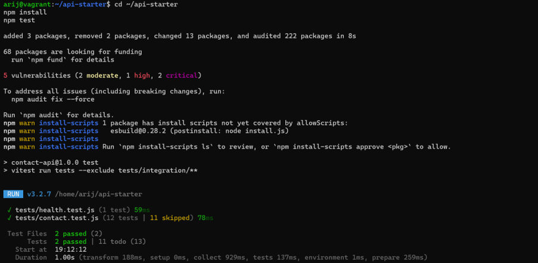

#### 2. Tableau OWASP rempli

### 🔍 Partie 2 : Validation et gestion des erreurs

#### 3. Création des fichiers de validation
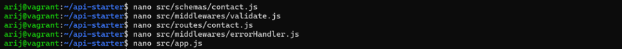

#### 4. Tests après validation
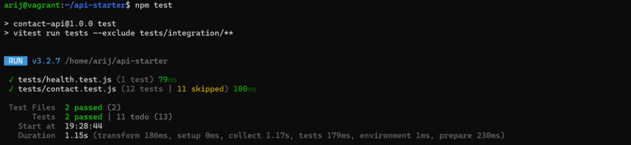

### 🛡️ Partie 3 : Durcissement HTTP

#### 5. Installation de Helmet et Rate Limit
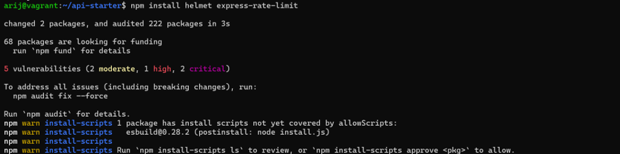

#### 6. Configuration de app.js et contact.js
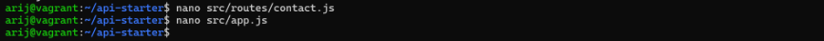

#### 7. Headers de sécurité (curl -I)
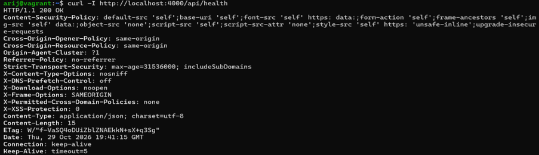

#### 8. Test du Rate Limiting
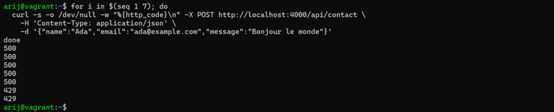

### 🧪 Partie 4 : Tests de routes et cas négatifs

#### 9. Couverture de code (npm run test:coverage)
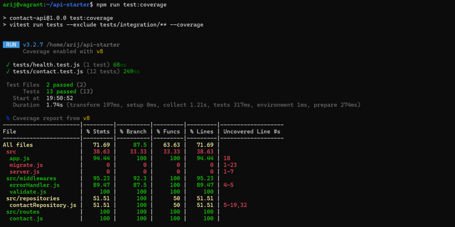

### 🐘 Partie 5 : Intégration avec PostgreSQL et migrations

#### 10. Démarrage de PostgreSQL (docker compose up)
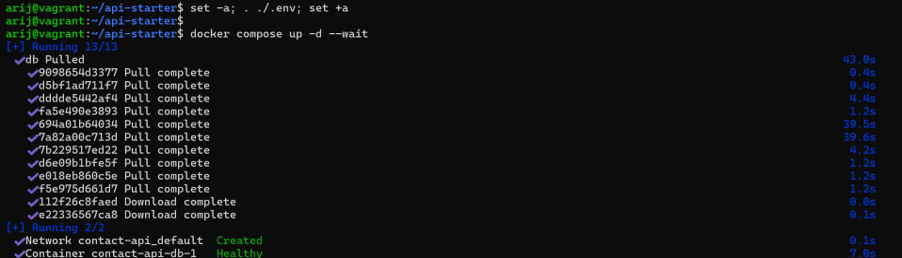

#### 11. Application des migrations
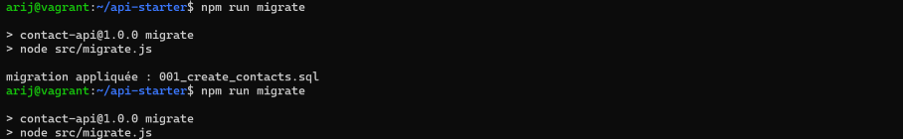

#### 12. Nouvelle migration (index email)
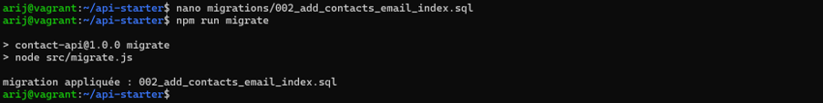

#### 13. Test d'intégration
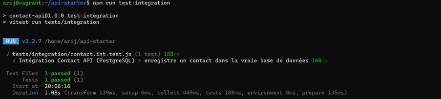

#### 14. Test manuel avec curl
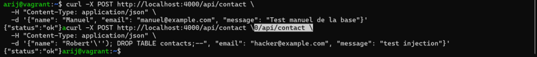

---

## 🛠️ Résumé des actions

| Étape | Outil | Action |
| :--- | :--- | :--- |
| **Validation** | Zod | Schéma `strict()` pour éviter le Mass Assignment. |
| **Sécurité HTTP** | Helmet | Headers de sécurité, désactivation de `x-powered-by`. |
| **Rate Limiting** | express-rate-limit | 5 requêtes par minute par IP. |
| **Gestion d'erreurs** | errorHandler | Erreur générique 500 sans stack trace. |
| **Tests unitaires** | Vitest | Tests des routes, health, validation. |
| **Tests d'intégration** | Vitest + PostgreSQL | Test de la vraie base de données. |
| **Migrations** | Node.js | Création et application des migrations SQL. |

---

  <b>Fait avec ❤️ par Arij Belaid</b>

